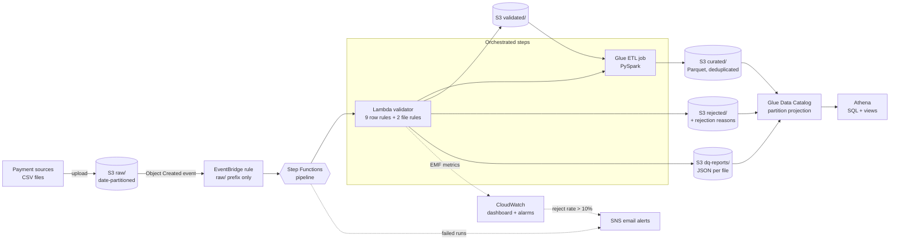

# AWS Financial Data Quality Platform

[](https://github.com/MubinMq2025/aws-financial-dq-platform/actions/workflows/tests.yml)


An event-driven data pipeline on AWS that **automatically validates financial transaction files, quarantines bad records with the reason they failed, and publishes clean, analytics-ready data**, with monitoring and email alerts. All infrastructure is defined in Terraform.

Built with synthetic data only. No real customer information is used.

---

## The problem

A fintech receives transaction files from many payment sources every day. Some contain duplicate IDs, missing customer IDs, negative or impossible amounts, invalid timestamps, wrong currency codes or missing columns. If that data reaches reporting unchecked, revenue figures and risk models are wrong.

This platform catches those problems **before** the data is used, keeps an audit trail of every rejected row, and tells a human when something needs attention.

## Architecture



### How a file moves through the system

1. A CSV lands in `raw/year=YYYY/month=MM/day=DD/`.
2. S3 emits an event; an **EventBridge** rule (filtered to `raw/`, so outputs never re-trigger it) starts the **Step Functions** pipeline.
3. The **Lambda validator** checks every row against a YAML data contract and writes three outputs: valid rows, rejected rows with the IDs of the rules they broke, and a JSON quality report. It also publishes data quality metrics to CloudWatch.
4. If anything was validated, the pipeline runs the **Glue** job, which casts types, removes duplicates **across days** (the Lambda only sees one file at a time) and writes partitioned **Parquet** to `curated/`.
5. Analysts query `curated`, `rejected` and the reports in **Athena**. New days are queryable immediately thanks to partition projection.
6. **CloudWatch** shows pipeline health on one dashboard; **SNS** emails on pipeline failures, reject rates above 10% and file-level warnings.

## Data quality rules

Rules live in [`config/dq_rules.yaml`](config/dq_rules.yaml), not in code, so they can be changed and reviewed without touching Python.

| ID | Rule | Type | Action |
|---|---|---|---|
| DQ001 | Mandatory fields present (IDs, timestamp, amount, currency) | Row | Reject |
| DQ002 | `transaction_id` unique within the file (first kept) | Row | Reject |
| DQ003 | Amount is numeric | Row | Reject |
| DQ004 | Amount > 0 and ≤ 1,000,000 | Row | Reject |
| DQ005 | Timestamp is ISO 8601 UTC | Row | Reject |
| DQ006 | Timestamp not in the future (5 min tolerance) | Row | Reject |
| DQ007 | Currency is an approved uppercase ISO code | Row | Reject |
| DQ008 | Payment method is a known value | Row | Reject |
| DQ009 | Status is a known value | Row | Reject |
| DQ100 | Row count between 1,000 and 50,000 | File | Warn |
| DQ101 | Reject rate below 10% | File | Warn |

Row rules reject a record that is definitely wrong. File rules only warn, because unusual (for example, a Black Friday spike) is not always wrong.

## Results

Validated against a synthetic generator that injects 11 labelled defect types:

- **100% of injected defects caught, 0 false rejections**, on every batch tested.
- Local run, Lambda run and Athena queries return **identical counts** at every stage (for example 9,466 valid / 534 rejected for one 10,000-row batch).
- Parquet output is **about 60% smaller** than the CSV input; a daily-totals query scanned **74 KB** instead of the full dataset.
- **Automated end-to-end test** (`scripts/e2e_test.py`) uploads three files to the live system at once:

| Scenario | Pipeline | Report | Reject rate |
|---|---|---|---|
| Clean (0% defects) | SUCCEEDED | PASSED | 0.0% |
| Dirty (25% defects) | SUCCEEDED | PASSED_WITH_WARNINGS | 24.7% |
| Broken (missing `amount` column) | FAILED, email alert sent | none | n/a |

## Tech stack

| Area | Technology | Why |
|---|---|---|
| Storage | Amazon S3 | Zoned data lake: raw, validated, rejected, curated, reports |
| Validation | AWS Lambda (Python, pandas layer) | Fast per-file checks, pay per run |
| ETL | AWS Glue 5.0 (PySpark) | Cross-day deduplication and Parquet conversion |
| Catalog and SQL | Glue Data Catalog, Amazon Athena | Serverless SQL over S3 with partition projection |
| Orchestration | Step Functions, EventBridge | Ordered steps, retries with backoff, failure branch |
| Monitoring | CloudWatch (EMF metrics, dashboard, alarms) | Business and technical health on one page |
| Alerting | Amazon SNS | Email on failures and quality breaches |
| Infrastructure | Terraform | Reproducible, reviewable, one-command teardown |
| Quality | pytest, GitHub Actions | 32 unit tests on every push |

## Design decisions

- **Rules as configuration.** A YAML data contract is the single source of truth for "good data".
- **Engine with no I/O.** `validator.py` takes a DataFrame and returns results, so the same code runs locally, in Lambda and in unit tests.
- **Least privilege everywhere.** The Lambda can only read `raw/` and write the three output zones; Glue can only read `validated/` and write `curated/`; EventBridge can only start this one state machine.
- **Idempotent by design.** The uploader skips files that already exist; the Lambda and Glue overwrite their own outputs, so retries never duplicate data.
- **Cost controls built in.** Lifecycle rules (raw to Infrequent Access after 30 days; temporary results deleted after 7), an Athena scan limit of 100 MB per query, Glue timeouts, and log retention of 14 days.
- **Event-driven, loop-safe.** Only `raw/` events trigger the pipeline, so its own outputs never re-trigger it.

## Repository structure

```
config/                 Environment config and the data quality contract (dq_rules.yaml)
src/data_generator/     Synthetic transactions with labelled, injected defects
src/ingestion/          Idempotent uploader to date-partitioned S3 keys
src/dq_platform/        Validation engine, outputs and report builder, local runner
lambda/                 Lambda handler (S3 in, S3 out, EMF metrics)
glue/                   PySpark curation job
sql/views/              Athena views as code
scripts/                Lambda build, view creation, end-to-end test
terraform/              All infrastructure (S3, Lambda, Glue, Athena, Step Functions, monitoring, alerts)
tests/                  Unit tests (fake S3, fixed clock)
docs/                   Ingestion contract
```

## Setup and deployment

**Prerequisites:** AWS account, AWS CLI v2, Terraform 1.6+, Python 3.12, Git.

```bash
# 1. Python environment
python -m venv .venv
source .venv/bin/activate            # Windows: .\.venv\Scripts\Activate.ps1
pip install -r requirements.txt
pytest -v

# 2. AWS credentials (temporary, no stored keys)
aws login --profile dq-dev
# Optional: a self-refreshing profile for Terraform and Python
#   [profile dq]
#   credential_process = aws configure export-credentials --profile dq-dev --format process
#   region = ap-southeast-2
export AWS_PROFILE=dq                # Windows: $env:AWS_PROFILE = "dq"

# 3. Alert email (git-ignored)
echo 'alert_email = "you@example.com"' > terraform/terraform.tfvars

# 4. Build the Lambda package and deploy everything
python scripts/build_lambda.py
cd terraform && terraform init && terraform apply && cd ..

# 5. Create the Athena views
python scripts/create_views.py --env dev

# 6. Send data through the pipeline
python -m src.data_generator.generate_transactions --env dev --date 2026-11-08
python -m src.ingestion.upload_raw --env dev

# 7. Run the end-to-end test
python scripts/e2e_test.py --env dev
```

Confirm the SNS subscription email after the first `terraform apply`.

**Teardown:** `cd terraform && terraform destroy` removes every resource.

## Example queries

```sql
-- Data quality trend by day
SELECT * FROM v_daily_dq_summary ORDER BY business_date;

-- Which rules fail most
SELECT rule_id, rule_name, SUM(failed_rows) AS failed_rows
FROM v_rule_failures_daily GROUP BY 1, 2 ORDER BY failed_rows DESC;

-- Daily business volumes from clean data
SELECT business_date, SUM(transactions) AS transactions, SUM(total_amount) AS total_amount
FROM v_daily_transactions GROUP BY business_date ORDER BY business_date;
```

## Lessons learned

- **The validator caught a bug in the generator.** About 4,400 rows were rejected as future-dated: "today's" synthetic timestamps were spread across the whole UTC day. Fixed at the source.
- **Least privilege meets Spark.** Glue's second run failed with AccessDenied: overwrite writes a `curated_$folder$` placeholder outside the allowed `curated/*` prefix. Found through the Step Functions execution history and fixed by allowing exactly that object.
- **IAM changes take a moment to propagate.** An immediate retry after a policy change can still fail.
- **Template escaping.** `jsonencode()` escapes `<` and `>`, which broke EventBridge input-transformer placeholders in alert emails.

## Possible next steps

- Incremental Glue processing (new partitions only) instead of a full rebuild.
- `repartition()` before writing to avoid many small Parquet files at scale.
- Move Terraform state to S3 with locking for team use.
- Separate prod environment and a CD workflow that runs `terraform plan` on pull requests.
- Move validation to Glue for files too large for Lambda's 15-minute limit.
